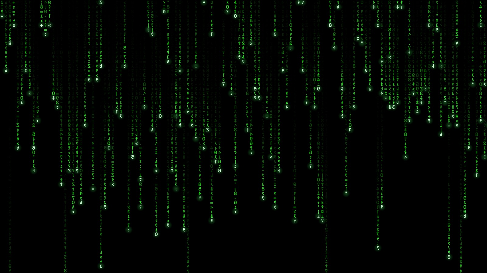

# GlyphFall

A screen saver for macOS: columns of mirrored katakana, digits and symbols
falling at their own pace, each led by a pale, glowing head and fading through
green into black. Inspired by the digital rain in the 1999 film *The Matrix*.

**Download and details: [plagens.dev/apps/glyphfall](https://plagens.dev/apps/glyphfall/)**
(Deutsch: [plagens.dev/de/apps/glyphfall](https://plagens.dev/de/apps/glyphfall/))

- macOS 14 Sonoma or later, Apple silicon or Intel
- Signed with a Developer ID and notarized by Apple
- No accounts, no ads, no tracking, no network access
- Free

This repository only hosts the releases. The source code is not public.

## Install

1. Download `GlyphFall-<version>.zip` from [Releases](https://github.com/andiqq/glyphfall/releases/latest) and unpack it (Safari does this automatically).
2. Double-click `GlyphFall.saver` and choose who to install it for.
3. In System Settings → Screen Saver, choose **GlyphFall** (under "Other").

Questions or problems: info@plagens.dev

---

*The Matrix* is a trademark of Warner Bros. Entertainment Inc. GlyphFall is an
independent project and is not affiliated with, endorsed by, or sponsored by
Warner Bros. Its glyphs are standard Unicode characters drawn in a system font;
it uses no footage, artwork or fonts from the film.
